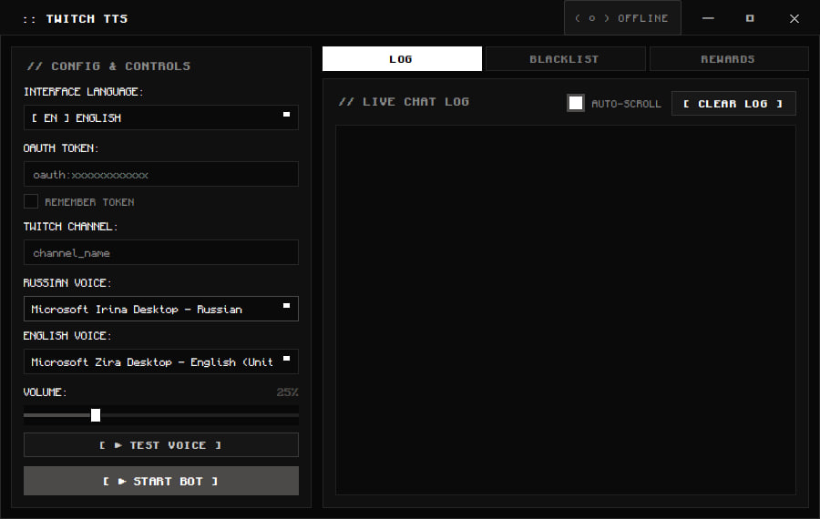

# Twitch Text-To-Speech

Minimalist pixelated desktop application that reads Twitch chat messages aloud using SAPI5 voices on Windows. Features a deep black pixel aesthetic, high-contrast typography, and dynamic adaptation to the Windows system accent color.



## Features
- **Pixel UI**: Custom frameless window with interactive status indicator `( ● ) LIVE` / `( ○ ) OFFLINE` and pixel typography (`Monocraft`).
- **Dashboard (Split View)**: Settings and live chat stream visible side-by-side on a single screen.
- **Voice & Volume Controls**: Selection of Windows SAPI5 voice engines and volume slider with a one-click `[ TEST VOICE ]` preview button.
- **System Adaptation**: Automatically inherits the Windows system accent color (via DWM registry) and system language (`SYSTEM`, `RU`, `EN`).
- **Inline Navigation**: Seamlessly switch between `[ LOG ]`, `[ BLACKLIST ]`, and `[ REWARDS ]` without modal popups.
- **Blacklist Filter**: Ignore specific chat users with fast addition and removal (via button or `Delete` key).
- **Voice per language**: choose separate Windows SAPI5 voices for Russian and English. Each chat message is split by alphabet, so mixed text is read by the matching voice. Defaults: the first Russian voice, and Microsoft Zira for English if installed. The `[ TEST VOICE ]` button reads one phrase in each language.

## Built with
- Python 3
- PyQt5
- TwitchIO
- pywin32 (Windows SAPI5)

## Requirements
- Windows 10 / 11 (64-bit)
- Twitch OAuth token (`oauth:xxxxxx`) and channel name
- At least one Russian and one English SAPI5 voice. Without a Russian voice, Russian text is read by an English voice and sounds wrong.

## Installation
1. Download `TwitchTTS.exe` from [Releases](../../releases).
2. Run `TwitchTTS.exe`.

## Usage
1. Enter your OAuth token and Twitch channel name.
2. Choose Russian and English voices, set the volume, press `[ TEST VOICE ]`.
3. Press `[ START BOT ]`.
4. Messages in chat that start with `!` (for example `!tts hello`) are read aloud.
5. To ignore a user, add their nickname on the `[ BLACKLIST ]` tab.

## Run from source
```bash
pip install -r requirements.txt
python app.py
```

## Settings
Settings are saved to `settings.json` next to the executable: channel, voices for each language, volume, blacklist, UI language, and optionally the OAuth token. If "Remember token" is on, the token is stored in plain text, so do not share this file.

## Credits
- UI design and window resizing: [@PlYtK](https://github.com/PlYtK)
- Per-language voices and packaging: [@aklauma](https://github.com/aklauma)

## License
Copyright (C) 2026 aklauma

This program is free software: you can redistribute it and/or modify it under the terms of the GNU General Public License as published by the Free Software Foundation, either version 3 of the License, or (at your option) any later version. See [LICENSE](LICENSE).

The Monocraft font is licensed under the SIL Open Font License 1.1.
